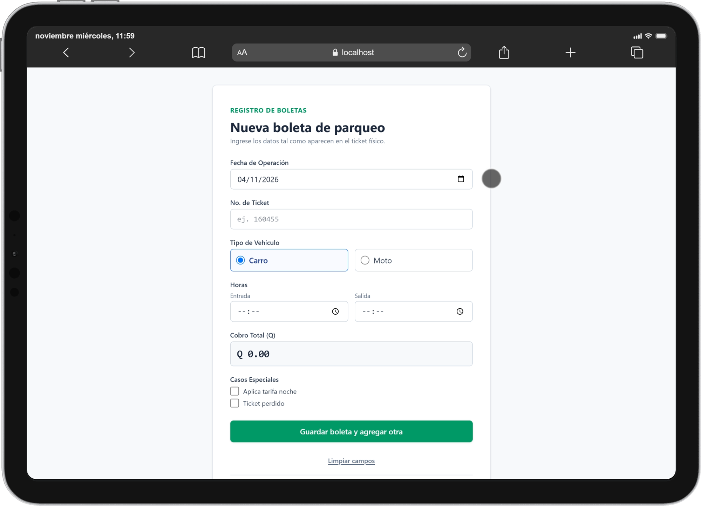
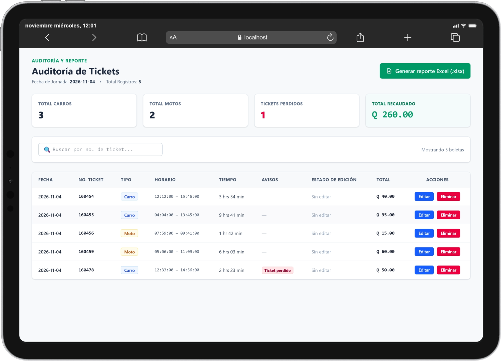

# Control de Parqueo — Editorial Sol

Sistema web para **digitalizar los tickets físicos de un parqueo**: los operadores transcriben las boletas, el sistema calcula el cobro automáticamente, permite auditar y corregir la jornada, genera un reporte en Excel y archiva todo de forma segura al cerrar el día.


---

## Tabla de contenido

1. [¿Qué problema resuelve?](#1-qué-problema-resuelve)
2. [Características](#2-características)
3. [Capturas de pantalla](#3-capturas-de-pantalla)
4. [Arquitectura](#4-arquitectura)
5. [Flujo de una jornada](#5-flujo-de-una-jornada)
6. [Estructura del repositorio](#6-estructura-del-repositorio)
7. [Inicio rápido](#7-inicio-rápido)
8. [Reglas de negocio (resumen)](#8-reglas-de-negocio-resumen)
9. [Trabajo simultáneo y seguridad de los datos](#9-trabajo-simultáneo-y-seguridad-de-los-datos)
10. [Documentación detallada](#10-documentación-detallada)
11. [Licencia](#12-licencia)

---

## 1. ¿Qué problema resuelve?

El parqueo de Editorial Sol emite tickets físicos de talonario. Al final del día, alguien debe transcribirlos, calcular cuánto se cobró, cuadrar la caja y dejar un respaldo. Este sistema reemplaza ese proceso manual por uno digital que:

- Calcula el cobro con las tarifas oficiales (sin errores de cálculo humano).
- Deja **trazabilidad** de cada corrección y de cada ticket anulado.
- Permite que **dos o más operadores trabajen a la vez**, desde dispositivos distintos, sobre los mismos datos.
- Entrega un **reporte Excel** y archiva la jornada solo cuando el operador confirma que el archivo se descargó.

## 2. Características

- **Registro rápido de tickets** (fecha, número, tipo de vehículo, horas y casos especiales) con vista previa del cobro.
- **Cálculo automático** de tiempo facturable y tarifa para carros y motos, con recargos por tarifa nocturna y ticket perdido.
- **Auditoría de la jornada**: totales, tabla de tickets activos y búsqueda por número.
- **Balance de horarios**: corrección de hora de entrada/salida con motivo obligatorio.
- **Anulación auditada**: el ticket se conserva en una tabla de auditoría con su motivo.
- **Reporte Excel** con dos hojas (tickets registrados y tickets eliminados).
- **Cierre transaccional**: se copia al histórico permanente y solo entonces se vacía la jornada.
- **Multioperador**: detección de cambios de otros operadores y de cierres concurrentes.
- 🔐 Acceso protegido con **HTTP Basic Auth** (credenciales compartidas por los operadores).
- Interfaz adaptada a **computadora y tablet**.

## 3. Capturas de pantalla

| Registro de tickets | Auditoría de la jornada |
|---|---|
|  |  |

> El recorrido completo de pantallas está en el [README del frontend](frontend/README.md#3-vistas-de-la-aplicación).

## 4. Arquitectura

El sistema permite que dos operadores trabajen simultáneamente desde diferentes dispositivos:

- **Operador 1:** utiliza una computadora para acceder al sistema.
- **Operador 2:** utiliza una tablet para acceder al sistema.

Ambos operadores interactúan con el **frontend desarrollado en Angular 22**, que se comunica con el backend mediante solicitudes HTTP a las rutas `/sol/*`, utilizando autenticación Basic Auth.

El **backend**, desarrollado con Express 5 y TypeScript, se encarga de procesar las solicitudes y gestionar la lógica del sistema.

Para el almacenamiento de información, el backend utiliza `mysql2` para conectarse a la base de datos **MySQL 8**, denominada `control_parqueo_sol`.

Además, utiliza **ExcelJS** para generar reportes en formato `.xlsx` con la información correspondiente.

- El **frontend** nunca calcula importes como dato definitivo: pide una vista previa al backend y muestra lo que este confirma.
- El **backend** es la fuente de verdad: valida, calcula, audita y protege la concurrencia.
- La **base de datos** tiene tres tablas: tickets activos, tickets eliminados (auditoría) e histórico de tickets cerrados.

## 5. Flujo de una jornada

El sistema sigue un flujo de trabajo dividido en tres etapas principales:

1. **Registro de tickets:** los operadores registran los tickets correspondientes a los vehículos que ingresaron al parqueo. Al finalizar el registro del día, se pasa a la etapa de auditoría.

2. **Auditoría:** se revisan los tickets registrados y se pueden realizar modificaciones en los horarios o anular tickets, siempre indicando el motivo correspondiente. Una vez finalizada la revisión, se genera el reporte en formato Excel.

3. **Confirmación de cierre:** después de generar el reporte Excel, el sistema solicita confirmar que la descarga se realizó correctamente. Si la descarga necesita repetirse, se puede regresar a la auditoría. Cuando se confirma la descarga y se confirma el cierre, la jornada pasa al histórico permanente.

**Histórico permanente:** almacena la información de las jornadas finalizadas. Una vez cerrado el proceso, se inicia una nueva jornada vacía para comenzar nuevamente con el registro de tickets.

> Finalizar el registro **no** cierra la jornada, y generar el Excel tampoco. Solo el **cierre confirmado** archiva y vacía los tickets activos.

## 6. Estructura del repositorio

```text
control-parqueo-editorial-sol/
├── backend/            # API REST (Node.js + Express + TypeScript + MySQL)
│   ├── src/
│   │   ├── script.sql  # Script de creación de la base de datos
│   │   └── ...
│   ├── .env.example
│   └── README.md       # Documentación del backend
├── frontend/           # SPA (Angular 22 + Tailwind CSS 4)
│   ├── src/
│   ├── docs/screenshots/   # Capturas usadas en los README
│   └── README.md       # Documentación del frontend
├── LICENSE             # MIT
└── README.md           # Este archivo
```

## 7. Inicio rápido

### Requisitos

- **Node.js** 18 o superior (se recomienda una versión LTS reciente; consulta además los requisitos de Angular 22 para el frontend).
- **pnpm**.
- **MySQL 8.0** o superior.

### Paso a paso

**1. Clonar el repositorio**

```bash
git clone https://github.com/josecoy-2025161/control-parqueo-editorial-sol
cd control-parqueo-editorial-sol
```

**2. Crear la base de datos**

```bash
mysql -u <usuario> -p < backend/src/script.sql
```

El script crea la base `control_parqueo_sol` y sus tres tablas.

**3. Configurar y levantar el backend**

```bash
cd backend
cp .env.example .env      # completa DB_USER, DB_PASSWORD, AUTH_USER y AUTH_PASS
pnpm install
pnpm dev                  # http://localhost:3000
```

**4. Levantar el frontend** (en otra terminal)

```bash
cd frontend
pnpm install
pnpm start                # http://localhost:4200
```

`pnpm start` usa un proxy que redirige `/sol/*` hacia `http://localhost:3000`, por lo que no hace falta configurar CORS ni URLs.

**5. Abrir la aplicación**

Entra a <http://localhost:4200>. El navegador pedirá las credenciales definidas en `AUTH_USER` y `AUTH_PASS` del backend.

> ⚠️ Define siempre `AUTH_USER` y `AUTH_PASS` en el `.env`. Si faltan, el backend usa valores por defecto inseguros. Nunca subas el `.env` al repositorio.

### Variables de entorno (backend)

| Variable | Descripción | Ejemplo |
|---|---|---|
| `PORT` | Puerto del servidor | `3000` |
| `DB_HOST` | Host de MySQL | `localhost` |
| `DB_PORT` | Puerto de MySQL | `3306` |
| `DB_USER` | Usuario de MySQL | `parqueo_app` |
| `DB_PASSWORD` | Contraseña de MySQL | — |
| `DB_NAME` | Nombre de la base de datos | `control_parqueo_sol` |
| `AUTH_USER` | Usuario compartido (Basic Auth) | — |
| `AUTH_PASS` | Contraseña compartida (Basic Auth) | — |

## 8. Reglas de negocio (resumen)

El horario regular del parqueo es de **04:30 a 17:30**. El tiempo facturable solo se acumula dentro de ese horario; el periodo nocturno cerrado no se cobra como tiempo adicional.

| Vehículo | Tarifa |
|---|---|
| **Carro** | Hasta 30 min: Q5 · De 31 a 60 min: Q10 · Luego Q5 por cada bloque de 30 min iniciado |
| **Moto** | Hasta 1 hora: Q5 · Luego Q5 por cada bloque de 30 min iniciado |

| Recargo | Monto | Cuándo aplica |
|---|---:|---|
| Tarifa nocturna | Q150 | El vehículo sigue dentro a las 17:30 o se marca manualmente |
| Ticket perdido | Q25 | Se marca manualmente |

Los recargos **se acumulan**: `Total = cobro por tiempo + Q150 (noche) + Q25 (perdido)`.

| Tiempo facturable | Carro | Moto |
|---|---:|---:|
| 30 min | Q5 | Q5 |
| 31 min | Q10 | Q5 |
| 1 h | Q10 | Q5 |
| 1 h 30 min | Q15 | Q10 |
| 1 h 31 min | Q20 | Q15 |

> Las reglas completas (estancias que cruzan la noche, fracciones, validaciones) están en el [README del backend](backend/README.md#7-reglas-de-negocio).

## 9. Trabajo simultáneo y seguridad de los datos

- El número de ticket es **único en la jornada activa**, garantizado por un índice único en la base de datos.
- Anular un ticket y cerrar la jornada son **operaciones transaccionales**: si falla la copia de auditoría o del histórico, no se borra nada.
- Editar o anular un ticket exige un **motivo** validado.
- Si otro operador cierra la jornada, la API responde con un conflicto (`409`) y la interfaz regresa al formulario de registro.
- El frontend consulta el estado de la jornada cada **3 segundos** para reflejar los cambios de otros operadores.
- Los importes **siempre** los calcula el backend; nunca se aceptan desde el cliente.

## 10. Documentación detallada

| Documento | Contenido |
|---|---|
| [`backend/README.md`](backend/README.md) | API REST, reglas de negocio, base de datos, Excel, cierre, errores y configuración |
| [`frontend/README.md`](frontend/README.md) | Vistas con capturas, arquitectura Angular, guards, sincronización entre operadores y despliegue |

## 11. Licencia

Distribuido bajo la licencia **MIT**. Consulta el archivo [`LICENSE`](LICENSE).