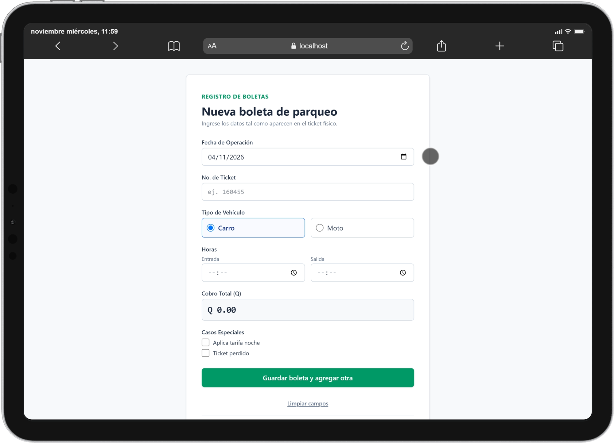
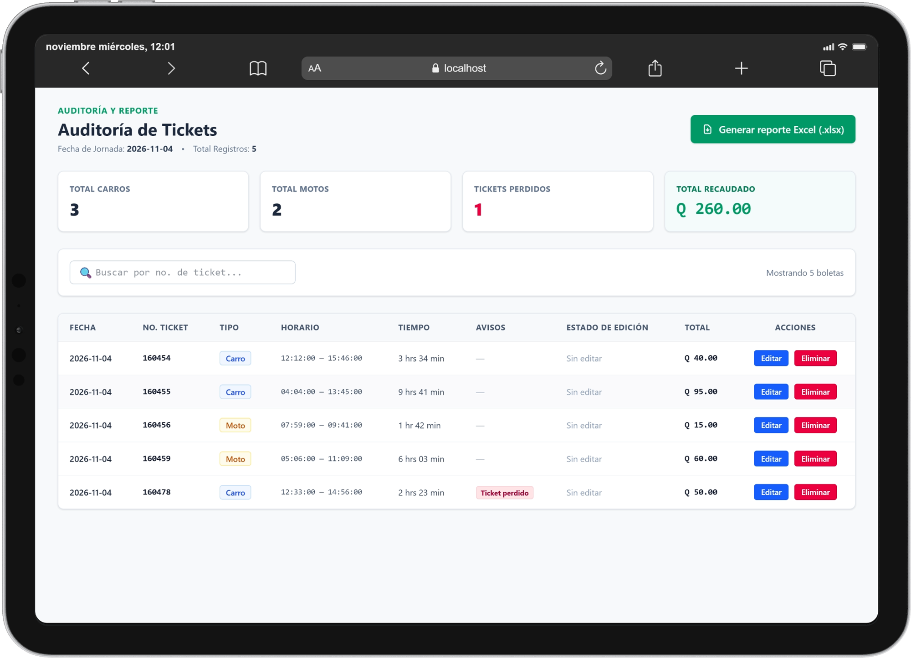
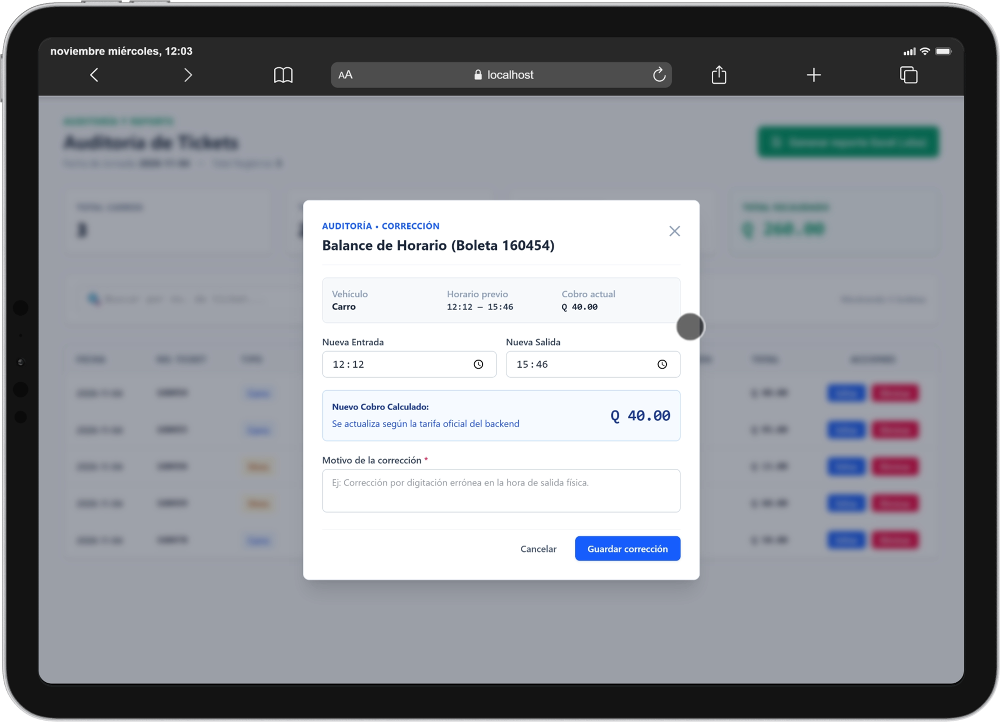
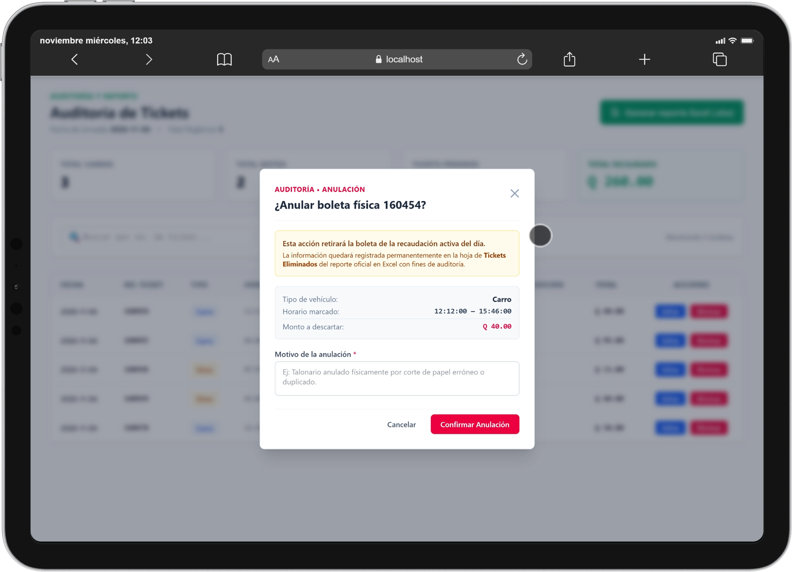
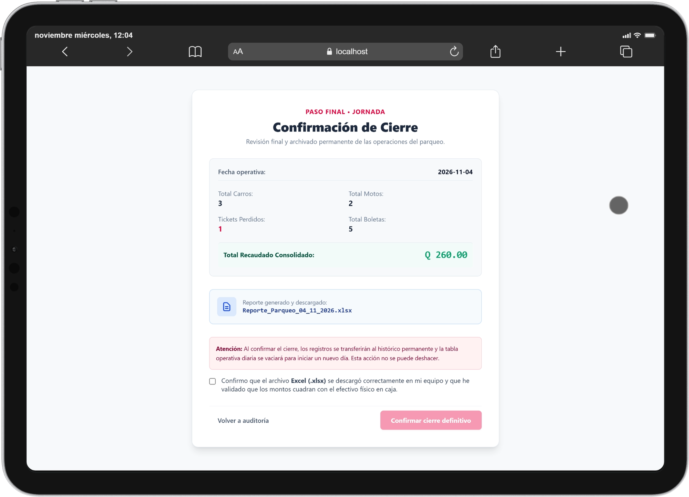

# Control de Parqueo (Editorial Sol) — Frontend

Aplicación web (SPA) con la que los operadores **transcriben los tickets físicos**, revisan y corrigen la jornada, descargan el reporte Excel y confirman el cierre del día. Consume la API del [backend](../backend/README.md), que es la **fuente de verdad** de importes, totales y estado de la jornada.

> Documentación general: [README de la raíz](../README.md) · API y reglas de negocio: [README del backend](../backend/README.md)

---

## Tabla de contenido

1. [Tecnologías](#1-tecnologías)
2. [Flujo de navegación](#2-flujo-de-navegación)
3. [Vistas de la aplicación](#3-vistas-de-la-aplicación)
4. [Instalación y ejecución](#4-instalación-y-ejecución)
5. [Configuración](#5-configuración)
6. [Estructura del proyecto](#6-estructura-del-proyecto)
7. [Arquitectura y comportamiento](#7-arquitectura-y-comportamiento)
8. [Integración con la API](#8-integración-con-la-api)
9. [Validaciones del formulario](#9-validaciones-del-formulario)
10. [Diseño y accesibilidad](#10-diseño-y-accesibilidad)
11. [Despliegue en producción](#11-despliegue-en-producción)
12. [Notas técnicas](#12-notas-técnicas)

---

## 1. Tecnologías

| Tecnología | Versión | Uso |
|---|---|---|
| Angular | 22 | Framework (componentes *standalone*, *signals*, control de flujo `@if` / `@for`) |
| TypeScript | ~6.0 | Lenguaje |
| RxJS | ~7.8 | Peticiones HTTP, *debounce* y *polling* |
| Tailwind CSS | 4 | Estilos (vía PostCSS) con paleta propia `sol-*` |
| pnpm | 12 | Gestor de paquetes |

## 2. Flujo de navegación

El sistema cuenta con tres vistas principales y dos ventanas modales para gestionar las operaciones:

1. **`/registro`:** vista principal donde los operadores registran los tickets de los vehículos. Al finalizar el registro del día, se redirige a la vista de auditoría.

2. **`/auditoria`:** permite revisar los tickets registrados y realizar las siguientes acciones:
   - **Editar:** abre un modal llamado *Balance de horario*, donde se pueden modificar los horarios de un ticket.
   - **Eliminar:** abre un modal llamado *Anular boleta*, donde se puede anular un ticket indicando el motivo correspondiente.
   - **Generar reporte Excel:** permite generar el reporte y continuar hacia la vista de cierre.

3. **`/cierre`:** vista donde se confirma el cierre definitivo de la jornada. Desde aquí se puede regresar a la auditoría o confirmar el cierre para iniciar una nueva jornada.

Una vez confirmado el cierre definitivo, el sistema redirige automáticamente a la vista `/registro` para comenzar una nueva jornada.

| Ruta | Pantalla | Carga | Protegida por |
|---|---|---|---|
| `/` | Redirige a `/registro` | — | — |
| `/registro` | Registro de tickets | Inmediata | `registroGuard` |
| `/auditoria` | Auditoría de tickets | *Lazy* | `auditoriaGuard` |
| `/cierre` | Confirmación de cierre | *Lazy* | `cierreGuard` |
| `**` | Cualquier otra ruta redirige a `/registro` | — | — |

> **Editar** y **Eliminar** no son rutas: se abren como **ventanas modales** sobre la auditoría.

## 3. Vistas de la aplicación

### 3.1. Registro de tickets (`/registro`)

Formulario para transcribir cada boleta física y guardarla; el operador continúa con la siguiente.



- **Campos:** fecha de operación (hoy por defecto, no admite fechas futuras), número de ticket (texto, máx. 20 dígitos), tipo de vehículo (Carro / Moto), hora de entrada y de salida, y las casillas *Aplica tarifa noche* y *Ticket perdido*.
- **Cobro total:** campo de **solo lectura**. Se solicita al backend (`POST /sol/tarifas/calcular`) con una espera de 350 ms tras el último cambio, y muestra *Calculando…* mientras responde.
- **Guardar boleta y agregar otra:** envía el ticket; si el servidor confirma, muestra el éxito y limpia el formulario **conservando la fecha y el tipo de vehículo** para capturar más rápido. Si falla (por ejemplo, número duplicado) conserva todos los datos y muestra el mensaje del servidor.
- **Limpiar campos:** vacía la captura sin guardar.
- **Finalizar registro del día y ver auditoría:** pasa a la auditoría sin borrar ni cerrar nada.

### 3.2. Auditoría de tickets (`/auditoria`)

Revisión de la jornada antes de generar el reporte.



- **Tarjetas de resumen:** total de carros, total de motos, tickets perdidos y total recaudado. Provienen del backend y **no cambian al buscar**.
- **Encabezado:** fecha de la jornada y total de registros.
- **Búsqueda por número de ticket** (con espera de 300 ms): filtra la tabla, no los totales. La búsqueda es parcial.
- **Tabla** (con desplazamiento horizontal en pantallas estrechas): fecha, número, tipo, horario, tiempo, avisos (*Ticket perdido* / *Tarifa noche*), estado de edición (*Sin editar* o *Editado* con el motivo), total y acciones **Editar** / **Eliminar**.
- **Generar reporte Excel (.xlsx):** descarga el archivo y lleva a la pantalla de cierre. Se deshabilita si no hay tickets.
- Estados contemplados: cargando, lista vacía y error de consulta.

### 3.3. Editar horario / balance (modal)

Corrige la hora de entrada y/o salida de un ticket.



- Muestra un resumen del ticket (vehículo, **horario previo** y **cobro actual**) y permite indicar la **nueva entrada** y la **nueva salida**; el **cobro recalculado** se obtiene del backend y se actualiza mientras se editan las horas.
- **Motivo obligatorio** (mínimo 6 caracteres, sin emojis ni símbolos no permitidos).
- Solo se modifican las horas: fecha, número, tipo de vehículo y ticket perdido no se pueden cambiar.
- No permite guardar el mismo horario que ya tenía el ticket.
- **Guardar corrección** actualiza la tabla y los totales; **Cancelar** (o ✕) no envía nada.

### 3.4. Anular boleta (modal)

Anulación auditada de un ticket capturado por error.



- Identifica la boleta (el número aparece en el título; además se muestran tipo de vehículo, horario y **monto a descartar**) y advierte que la anulación **queda registrada en la hoja *Tickets Eliminados* del Excel**; no es un borrado silencioso.
- **Motivo obligatorio** con las mismas reglas que la edición.
- Botón rojo para confirmar; **Cancelar** (o ✕) no modifica nada. Si falla, el ticket sigue en la tabla.

### 3.5. Confirmación de cierre (`/cierre`)

Último paso: revisar el resumen, verificar el archivo y cerrar la jornada.



- Muestra la fecha operativa, totales (carros, motos, perdidos, boletas), **total recaudado consolidado** y el **nombre del archivo** descargado (ej. `Reporte_Parqueo_04_11_2026.xlsx`).
- Para habilitar **Confirmar cierre definitivo** el operador debe marcar la casilla en la que declara que el Excel se descargó y que los montos cuadran con la caja. Es una **confirmación manual**.
- Tras la respuesta satisfactoria del servidor, el sistema regresa a `/registro` con la jornada vacía.
- **Volver a auditoría** permite regresar (por ejemplo, para volver a generar el archivo si no se descargó) sin cerrar nada.

## 4. Instalación y ejecución

### Requisitos

- Una versión **LTS reciente de Node.js** compatible con Angular 22.
- **pnpm**.
- El [backend](../backend/README.md) levantado en `http://localhost:3000`.

### Pasos

```bash
cd frontend
pnpm install
pnpm start        # http://localhost:4200
```

Al abrir la aplicación, el navegador mostrará su cuadro nativo de **inicio de sesión** (HTTP Basic Auth). Usa las credenciales `AUTH_USER` / `AUTH_PASS` del `.env` del backend.

### Scripts

| Script | Comando real | Descripción |
|---|---|---|
| `pnpm start` | `ng serve --proxy-config proxy.conf.json` | Servidor de desarrollo con proxy hacia el backend |
| `pnpm build` | `ng build` | Compilación de producción (`dist/frontend/browser`) |
| `pnpm watch` | `ng build --watch --configuration development` | Compilación continua en modo desarrollo |
| `pnpm test` | `ng test` | Ejecuta pruebas unitarias |

## 5. Configuración

### URL de la API

La URL base está centralizada en `src/environments/environment.ts`:

```ts
export const environment = {
  production: true,
  apiUrl: '/sol',               // ruta relativa: la API se sirve en el mismo origen
  pollingIntervalMs: 3000,      // frecuencia con la que se consulta el estado de la jornada
};
```

`environment.development.ts` define los mismos valores.

### Proxy de desarrollo

`proxy.conf.json` redirige las peticiones `/sol/*` al backend:

```json
{
  "/sol": { "target": "http://localhost:3000", "secure": false, "changeOrigin": true }
}
```

Si tu backend corre en otro puerto, cambia `target`. El proxy **solo aplica con `pnpm start`**; para producción consulta la [sección 11](#11-despliegue-en-producción).

## 6. Estructura del proyecto

```text
frontend/
├── docs/screenshots/               # Capturas usadas en los README
├── public/                         # Recursos estáticos (favicon)
├── src/
│   ├── app/
│   │   ├── core/
│   │   │   ├── guards/             # registro, auditoria, cierre (y auth, sin uso actual)
│   │   │   ├── interceptors/       # basic-auth.interceptor.ts
│   │   │   └── services/           # jornada-polling, reportes, auth
│   │   ├── features/
│   │   │   ├── registro/           # Pantalla de registro + servicio
│   │   │   ├── auditoria/          # Pantalla, servicio y modales
│   │   │   │   └── components/     # balance-modal, anular-modal
│   │   │   └── cierre/             # Pantalla de cierre + servicio
│   │   ├── models/                 # Interfaces TypeScript (DTO de la API)
│   │   ├── shared/
│   │   │   ├── pipes/              # quetzal, ticket-duration
│   │   │   └── validators/         # text-motivo.validator.ts
│   │   ├── app.component.ts        # Raíz: inicia el polling de la jornada
│   │   ├── app.config.ts           # Router, HttpClient e interceptor
│   │   └── app.routes.ts           # Rutas y guards
│   ├── environments/
│   ├── index.html
│   ├── main.ts
│   └── styles.css                  # Tailwind + paleta de colores
├── proxy.conf.json
├── angular.json
└── package.json
```

Cada *feature* mantiene separadas la **interfaz** (componente), la **comunicación con la API** (servicio) y los **modelos**.

## 7. Arquitectura y comportamiento

### 7.1. Autenticación

El backend responde `401` con la cabecera `WWW-Authenticate`, por lo que el **navegador muestra su diálogo nativo** de Basic Auth y reutiliza las credenciales en las siguientes peticiones. La aplicación no tiene pantalla de login propia ni guarda contraseñas.

El interceptor (`basic-auth.interceptor.ts`) además:

- Marca las peticiones con `withCredentials: true`.
- Añade `Authorization: Basic …` solo si existe un token en `sessionStorage` (`sol_auth`).
- Ante un `409` con código `JORNADA_CERRADA` o `JORNADA_YA_CERRADA`, avisa al servicio de jornada de que otro operador cerró y devuelve al operador al registro.

### 7.2. Sincronización entre operadores

No hay WebSockets. La coordinación se logra así:

| Mecanismo | Qué hace |
|---|---|
| **Polling** cada 3 s a `GET /sol/jornada/estado` | Detecta cambios de otros operadores (usa el campo `version`, totales, fase y fecha) y recarga la auditoría |
| **Fase de la jornada** del backend (`REGISTRO` / `AUDITORIA`) | Si otro operador finaliza el registro, esta sesión pasa a auditoría; si la jornada se vacía, vuelve a registro |
| **`BroadcastChannel`** (`sol_parqueo_channel`) y `localStorage` | Sincronizan al instante **varias pestañas del mismo navegador** (cambio de fase y tickets modificados) |
| Recarga tras cada operación | Después de editar, anular o registrar, la tabla y los totales se vuelven a pedir al servidor |

Claves de `localStorage` usadas: `sol_fase_jornada` y `sol_tickets_sync`.

### 7.3. Guards

| Guard | Permite entrar si… | Si no, redirige a |
|---|---|---|
| `registroGuard` | La jornada está vacía o en fase `REGISTRO` | `/auditoria` (si la fase ya es `AUDITORIA`) |
| `auditoriaGuard` | Hay tickets y la fase es `AUDITORIA` | `/registro` |
| `cierreGuard` | La fase es `AUDITORIA` y ya se generó el Excel en esta sesión | `/registro` o `/auditoria` |

> Si recargas la página en `/cierre`, se pierde el dato en memoria de que el Excel fue descargado y la aplicación te devuelve a `/auditoria`.

### 7.4. Descarga del Excel

1. En la auditoría se pide `GET /sol/reportes/excel` como **archivo binario** (`blob`).
2. El nombre se toma de la cabecera `Content-Disposition` (con un nombre alternativo si no está disponible).
3. Se dispara la descarga en el navegador y se navega a `/cierre` enviando el nombre del archivo y el resumen.
4. **Generar el reporte no cierra la jornada.**

### 7.5. Cierre

`POST /sol/cierre/confirmar` solo se envía después de marcar la casilla de confirmación. No se simula ningún cierre local: la aplicación vuelve al registro únicamente tras la respuesta satisfactoria. El botón se deshabilita mientras se procesa para evitar envíos repetidos.

### 7.6. Formato de datos

| Elemento | Formato |
|---|---|
| Moneda | `Q 15.00` (pipe `quetzal`) |
| Duración | Texto legible del backend (ej. `1 hr 25 min`); alternativa calculada desde los minutos (pipe `ticketDuration`) |
| Número de ticket | Siempre **texto**, para conservar ceros iniciales |
| Horas enviadas a la API | `HH:mm` (24 h) |

## 8. Integración con la API

Todas las rutas usan la base `/sol` y HTTP Basic Auth.

| Método | Endpoint | Dónde se usa |
|---|---|---|
| `GET` | `/sol/jornada/estado` | Polling y guards |
| `POST` | `/sol/jornada/finalizar-registro` | Botón *Finalizar registro del día* |
| `POST` | `/sol/tarifas/calcular` | Vista previa del cobro (registro y balance) |
| `POST` | `/sol/tickets` | Guardar boleta |
| `GET` | `/sol/tickets/activos` (`?numero=`) | Tabla y totales de auditoría; resumen de cierre |
| `PATCH` | `/sol/tickets/:id/balance` | Guardar corrección de horario |
| `DELETE` | `/sol/tickets/:id` | Anular ticket (cuerpo: `motivoEliminacion`) |
| `GET` | `/sol/reportes/excel` | Descarga del reporte |
| `POST` | `/sol/cierre/confirmar` | Confirmar cierre |

`GET /sol/acceso/verificar`, `GET /sol/tickets/buscar/:numero` y `GET /sol/cierre/historico` existen en el backend y en el código del frontend (servicios o modelos), pero **ninguna pantalla los utiliza todavía**.

**Manejo de errores:** los componentes muestran el campo `mensaje` que devuelve el backend y, si no existe, un texto genérico. Cuando una operación falla, los datos del formulario se conservan; el éxito solo se muestra tras la confirmación del servidor.

## 9. Validaciones del formulario

Validaciones en la interfaz (el backend las vuelve a aplicar):

| Campo | Regla |
|---|---|
| Fecha de operación | Obligatoria; no puede ser futura |
| Número de ticket | Obligatorio; solo dígitos (máx. 20) |
| Hora de entrada / salida | Obligatorias; la salida debe ser distinta de la entrada |
| Motivo (edición y anulación) | Obligatorio; mínimo 6 caracteres; solo letras (con tildes, `ñ`, `ü`), números, espacios y `. , ; : ( ) # - _ /` |
| Balance | Al menos una hora debe cambiar respecto al ticket original |

## 10. Diseño y accesibilidad

- Estilo administrativo: fondo claro, superficies blancas, bordes sutiles y jerarquía tipográfica clara.
- **Verde** para acciones principales, **azul** para edición/navegación y **rojo** para anulaciones, errores y cierre.
- Paleta definida en `src/styles.css` (`sol-green`, `sol-blue`, `sol-red`, `sol-bg`, `sol-surface`, `sol-border`).
- Adaptada a **computadora y tablet**: las tarjetas y formularios se reorganizan y la tabla tiene barra de desplazamiento horizontal visible.
- Campos con etiquetas visibles, errores junto al campo, foco visible y estados diferenciados con texto además de color (por ejemplo *Ticket perdido*, *Editado*).
- Botones con indicador de carga y deshabilitados durante el envío.

## 11. Despliegue en producción

`pnpm build` genera archivos estáticos en `dist/frontend/browser`. Como `apiUrl` es `/sol` (ruta relativa) y el `proxy.conf.json` solo existe en desarrollo, en producción hay que servir el frontend y **redirigir `/sol` al backend** bajo el mismo dominio. Ejemplo con Nginx:

```nginx
server {
    listen 80;
    server_name parqueo.ejemplo.com;

    root /var/www/parqueo/browser;
    index index.html;

    # API del backend (mismo origen → sin CORS y con Basic Auth nativo)
    location /sol/ {
        proxy_pass http://127.0.0.1:3000;
        proxy_set_header Host $host;
        proxy_set_header X-Real-IP $remote_addr;
    }

    # Rutas de la SPA
    location / {
        try_files $uri $uri/ /index.html;
    }
}
```

Recomendaciones: usar **HTTPS** (Basic Auth envía las credenciales codificadas, no cifradas) y ejecutar el backend como una sola instancia.

## 12. Notas técnicas

- Las horas se muestran tal como las entrega la API (por ejemplo `12:00:00`) y las fechas en formato `AAAA-MM-DD`.
- El orden y los totales vienen del backend; el frontend no los recalcula.
